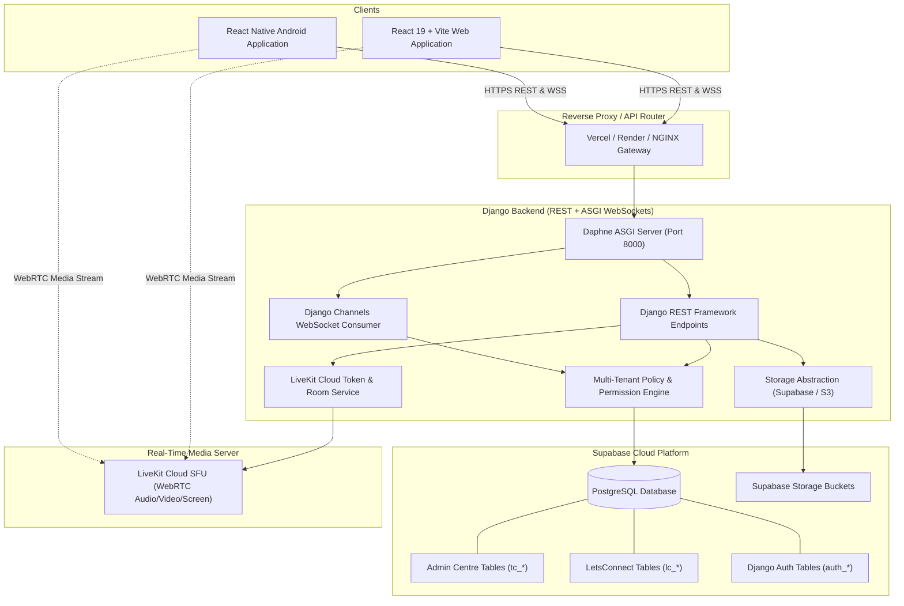

# LetsConnect — System Architecture & Design Specification

## 1. High-Level Architecture Overview

LetsConnect is an enterprise-grade collaboration platform inspired by Microsoft Teams, providing multi-tenant organizational chat, teams, channels, audio/video conferencing (LiveKit), presence, and calendar scheduling across Web and Android clients.

---

## 2. Component Architecture

### 2.1 Backend Architecture
- **Language**: Python 3.12+ (tested on Python 3.14.3)
- **Framework**: Django 5.x + Django REST Framework 3.15+
- **Real-Time Protocol**: Django Channels + Daphne ASGI handling WebSockets for:
  - Real-time chat message delivery (`chat_message`)
  - Participant typing indicators (`typing`)
  - User presence transitions (`presence_change`)
  - Channel updates and reactions (`reaction_update`)
- **Database Engine**: `psycopg2-binary` connecting directly to Supabase PostgreSQL pooler.

### 2.2 Web Client Architecture
- **Framework**: React 19 with TypeScript
- **Tooling**: Vite for lightning-fast HMR and optimized production bundles
- **Routing**: React Router v6 with authenticated route guards and context validation
- **State Management**: Context API + custom hooks with persistent session cache
- **Theme**: Teams dark-mode by default, with toggleable light mode
- **Real-Time Transport**: Native WebSocket client with auto-reconnection and exponential backoff
- **LiveKit SDK**: `livekit-client` for real-time video/audio calling and screen sharing

### 2.3 Android Mobile Architecture
- **Framework**: React Native with TypeScript
- **Target**: Android (SDK 34+)
- **Session Security**: Encrypted token storage (`AsyncStorage` / Secure Keystore)
- **Shared API Contract**: Identical REST payloads and WebSocket protocol as web client

---

## 3. Dynamic Multi-Tenant Flow

1. **Organization Creation**: An administrator creates a new organization via Admin Centre (`tc_organizations`).
2. **User Directory**: Employees are added to the organization (`tc_employees`).
3. **Team & Channel Setup**: Teams are provisioned (`tc_teams`) with channels (`tc_channels`) and roles (`tc_team_memberships`).
4. **Immediate Visibility**: When the user signs in to LetsConnect, the backend inspects `tc_employees` and `tc_team_memberships` in real time. **Zero code deployment or cache invalidation is needed for new organizations**.
5. **Context Enforcement**: The backend verifies the user's active organization ID on every request, ensuring complete tenant isolation.
